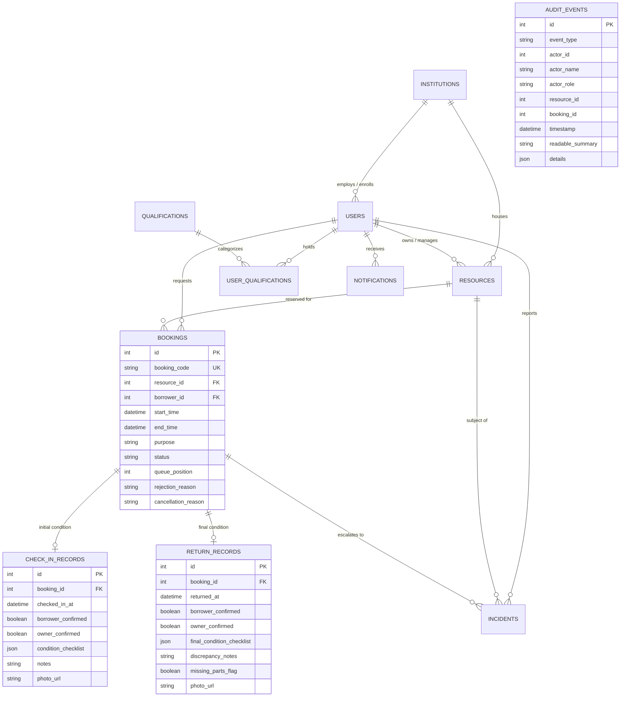
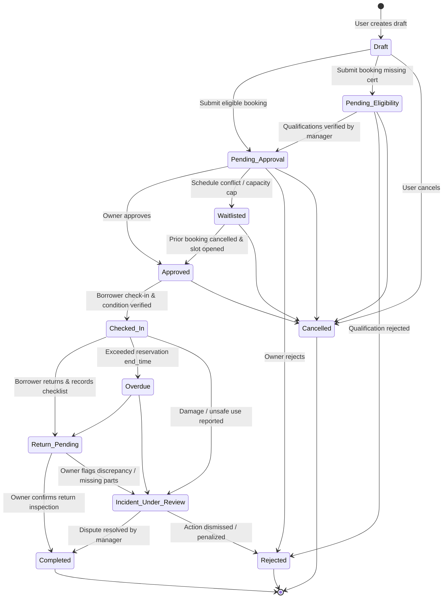

# ShareSphere System Architecture & Database Schema
> Trusted Resource Sharing & Accountability Platform

---

## 1. System Architecture Diagram

```mermaid
graph TB
    subgraph Client Layer [Frontend - React 19 + TypeScript + Vite]
        UI[Tailwind CSS v4 & Lucide UI]
        AuthCtx[AuthContext & Demo Switcher]
        APIClient[REST API Client /api]
    end

    subgraph Server Layer [Backend - FastAPI & Python 3.14]
        Router[FastAPI Application Routes]
        AuthEngine[JWT & PBKDF2 Password Hashing]
        FSM[Booking State Machine & Conflict Guard]
        AIMatcher[Explainable Capability & Safety Matcher]
        AuditLogger[Append-Only Audit Event Logger]
    end

    subgraph Data Layer [Database - SQLAlchemy ORM]
        DB[(SQLite / PostgreSQL Engine)]
        UsersTable[Users & Institutions]
        ResourcesTable[Resources & Operating Rules]
        BookingsTable[Bookings & Handover Checklists]
        AuditTable[Immutable Audit Events]
        IncidentsTable[Incidents & Dispute History]
        NotifsTable[In-App Notifications]
    end

    Client Layer -->|HTTP / JSON with JWT Bearer| Server Layer
    Router --> AuthEngine
    Router --> FSM
    Router --> AIMatcher
    FSM --> AuditLogger
    Server Layer -->|SQLAlchemy 2.0 ORM| Data Layer
```

---

## 2. Database Schema (Entity-Relationship)



---

## 3. Booking Lifecycle State Machine


